<p align="center">
  
</p>

# myth — native Rust speech on NVIDIA Jetson

Myth is a native Rust speech synthesizer and browser voice workshop for NVIDIA
Jetson Orin Nano. CUDA, TensorRT and cuBLAS accelerate inference; reference voices
are prepared once and retained for subsequent speech. The runtime does not invoke
Python or PyTorch.

This repository contains the native release, bundled workshop and four reference
recordings. **It is a source-and-recordings release, not a complete model download.**
Running speech requires exported model tensors, tokenizer data, prepared voice
assets and compatible TensorRT engines in addition to this repository.

## Requirements

- NVIDIA Jetson Orin Nano with a working NVIDIA driver, CUDA, TensorRT and cuBLAS.
  Engines must match the target hardware and installed TensorRT runtime.
- A Rust toolchain with Cargo, Git, a C/C++ compiler and the CUDA/TensorRT headers.
  Build on the Jetson for its AArch64 Linux environment.
- Native audio libraries: `libsndfile.so.1` and `libsoxr.so.0` for reference
  decoding/resampling; `libmp3lame.so.0` for MP3 output. WAV output needs no MP3 encoder.
- An exported asset bundle: token-generation engine, prompt/tokenizer tables,
  prepared voice/reference tensors, flow, Conformer, mel, meanflow and HiFT assets,
  and their JSON manifests with SHA256 pins.
- For the browser workshop: the preparation-model manifest and tensors, a prompt
  template, an inference pipeline template and a writable state directory.

The original deployment used a 4 GiB container memory limit without swap; that is
a deployment reference, not a promise that every Jetson configuration fits it.
Docker with NVIDIA Container Runtime is optional for the manual launch below.

## 1. Get the code and build

Run these commands on the Jetson:

```sh
git clone https://github.com/muttleydosomething/myth-jetson-nano.git
cd myth-jetson-nano

# Verify the published source and recording checksums.
sha256sum --check rust/SHA256SUMS

# Build the standalone Rust executable and native GPU bridge.
cargo build --manifest-path rust/Cargo.toml --release --locked
mkdir -p release
bash rust/native/build.sh "$PWD/release/libchatterbox_trt.so"
```

The executable is `rust/target/release/chatterbox-rs`. That internal name and the
bridge filename remain compatibility identifiers; the project is Myth.
`CUDA_HOME` can select a CUDA installation other than `/usr/local/cuda`;
`CXX` can select the bridge compiler.

Make CUDA, TensorRT and cuBLAS discoverable by the dynamic linker. For a standard
Jetson installation:

```sh
export LD_LIBRARY_PATH="/usr/lib/aarch64-linux-gnu:/usr/local/cuda/lib64:/usr/local/cuda/targets/aarch64-linux/lib:${LD_LIBRARY_PATH:-}"
export MYTH_WAVEFORM_BACKEND=cuda
```

## 2. Restore or prepare the model assets

Restore an existing exported asset bundle and its prepared voices to the Jetson.
The WAV recordings under [samples/](samples/) are source recordings; they are
**not** substitutes for the model weights or prepared conditioning tensors.

The aggregate inference manifest has `schema_version: 1` and these pinned
`{ "path": "...", "sha256": "..." }` entries:

| Entry | Required asset |
| --- | --- |
| `bridge` | The native GPU bridge built above |
| `engine` | Token-generation TensorRT engine |
| `prompt` | Prompt/tokenizer and voice-conditioning manifest |
| `reference` | Prepared S3Gen voice-reference manifest |
| `flow` | Flow assets |
| `conformer` | Conformer assets |
| `mel` | Mel-projection assets |
| `meanflow` | Meanflow assets |
| `hift` | HiFT waveform assets |

Paths in an aggregate pipeline resolve relative to that manifest. Its nested
manifests admit their own tensors and engines. If paths or bytes change, update
the affected SHA256 pins from the innermost manifest outward: assets → pipeline
→ service catalogue. Rebuild hardware-specific engines when necessary; changing
a checksum alone does not make an incompatible engine usable.

For first-time export, [rust/README.md](rust/README.md) documents the tensor
contracts and numerical acceptance gates, and [rust/native/](rust/native/)
contains the Conformer, meanflow and HiFT graph exporters. These are build-time
tools with environment-specific dependencies. **This release does not yet provide
a single-command checkpoint-to-asset installer.** A fresh clone without that asset
bundle cannot synthesize speech.

The files in [rust/deployment/](rust/deployment/) are exact original deployment
snapshots. Their absolute paths, image identity and checksums describe the original
machine; do not run that launcher unchanged on a new installation.

## 3. Start the speech API

Once a prepared voice pipeline is available, create `release/service.json` using
this catalogue shape. Replace the pipeline path and `PIPELINE_SHA256` with your
actual values; `sha256sum /absolute/path/to/pipeline.json` gives the digest.

```json
{
  "schema_version": 1,
  "model": "myth",
  "voices": {
    "my-voice": {
      "display_name": "my voice",
      "pipeline": "/absolute/path/to/pipeline.json",
      "sha256": "PIPELINE_SHA256"
    }
  },
  "sampling": {
    "temperature": 0.8,
    "top_k": 1000,
    "top_p": 0.95,
    "repetition_penalty": 1.2
  },
  "seed": 42,
  "max_gen_len": 600
}
```

Launch from the repository root:

```sh
SERVICE_SHA256=$(sha256sum release/service.json | cut -d ' ' -f 1)
./rust/target/release/chatterbox-rs serve \
  "$PWD/release/service.json" "$SERVICE_SHA256" 127.0.0.1:8004
```

Keep that terminal running. In another terminal, check admission and request speech:

```sh
curl --fail-with-body http://127.0.0.1:8004/health
curl --fail-with-body http://127.0.0.1:8004/get_predefined_voices

curl --fail-with-body http://127.0.0.1:8004/v1/audio/speech \
  -H 'Content-Type: application/json' \
  -d '{"model":"myth","input":"All systems are operating within normal parameters.","voice":"my-voice","response_format":"wav","speed":1.0,"seed":42}' \
  --output speech.wav
```

Play `speech.wav` to check the result. A healthy listener alone does not prove
that the inference assets work. The API also supports MP3 and Opus when their
native codec dependencies are available. Concurrent inference returns HTTP 429;
wait for the active request to finish. Ctrl+C gracefully drains active work.

## 4. Enable the browser workshop

The minimal catalogue above serves the speech API. To enable the workshop, add
a top-level `workshop` object to that same service catalogue:

```json
{
  "ui_root": "/absolute/path/to/myth-jetson-nano/rust/ui",
  "state_root": "/absolute/path/to/myth-state",
  "preparation": {
    "path": "/absolute/path/to/preparation.json",
    "sha256": "PREPARATION_SHA256"
  },
  "prompt": {
    "path": "/absolute/path/to/prompt-template.json",
    "sha256": "PROMPT_SHA256"
  },
  "pipeline": {
    "path": "/absolute/path/to/pipeline-template.json",
    "sha256": "PIPELINE_SHA256"
  }
}
```

Use actual absolute paths and digests. Create the state directory before starting
and ensure the service user can write there. Recompute the service catalogue's
SHA256 and relaunch with the same command. Open `http://127.0.0.1:8004/` in a
browser on the Jetson to use the workshop.

The bundled assets are ready to serve; Node.js is only needed to rebuild the
TypeScript additions:

```sh
npm ci --prefix rust/workshop
node rust/workshop/build.mjs rust/ui/vendor
```

Import a reference recording through the workshop and use **Apply** to publish its
prepared voice. Both normalization variants are retained. Reuse existing prepared
state when restoring an installation so the references need not be prepared again.
Voice deletion uses the existing external authority contract; see the
[service and workshop contract](rust/README.md#native-service-and-workshop-contract)
before configuring `delete_authority_sha256`.

For access from another computer without opening a public port, use SSH forwarding
to the Jetson's loopback listener:

```sh
ssh -N -L 8004:127.0.0.1:8004 your-user@your-jetson
```

Then open `http://127.0.0.1:8004/` on that computer.

## Troubleshooting

| Symptom | Check |
| --- | --- |
| Shared library cannot load | CUDA/TensorRT/cuBLAS installation, linker paths and the native audio libraries |
| Manifest or checksum rejected | Actual bytes, paths and nested pins; recompute dependent pins after editing |
| TensorRT engine cannot load | Target hardware, TensorRT compatibility and the bridge build |
| No selectable voices | Restore prepared state or configure preparation assets and import a recording |
| HTTP 429 | Another inference, upload or lifecycle operation owns the engine |
| Workshop cannot open | The catalogue needs its `workshop` object, a valid UI root and writable state root |

## Repository contents

- [rust/](rust/): standalone crate, locked dependencies, C ABI bridge and regressions.
- [rust/README.md](rust/README.md): detailed development record and acceptance evidence.
  Earlier dated sections describe earlier conversion stages.
- [rust/ui/](rust/ui/) and [rust/workshop/](rust/workshop/): bundled workshop and its
  TypeScript build sources.
- [samples/](samples/): ships computer, tpol, the doctor and seven recordings;
  [manifest](samples/manifest.json) lists their original checksums.
- [rust/deployment/](rust/deployment/): original production deployment examples.
- [rust/public-backup.json](rust/public-backup.json): source provenance.
  [rust/SHA256SUMS](rust/SHA256SUMS) covers the published release.

## Licensing and attribution

See [LICENSE](LICENSE) and [rust/LICENSE](rust/LICENSE) for software licences and
required upstream notices. Reference recordings are not relicensed under those
software licences. Historical source identifiers and attribution remain in the
native release to preserve compatibility and provenance.
